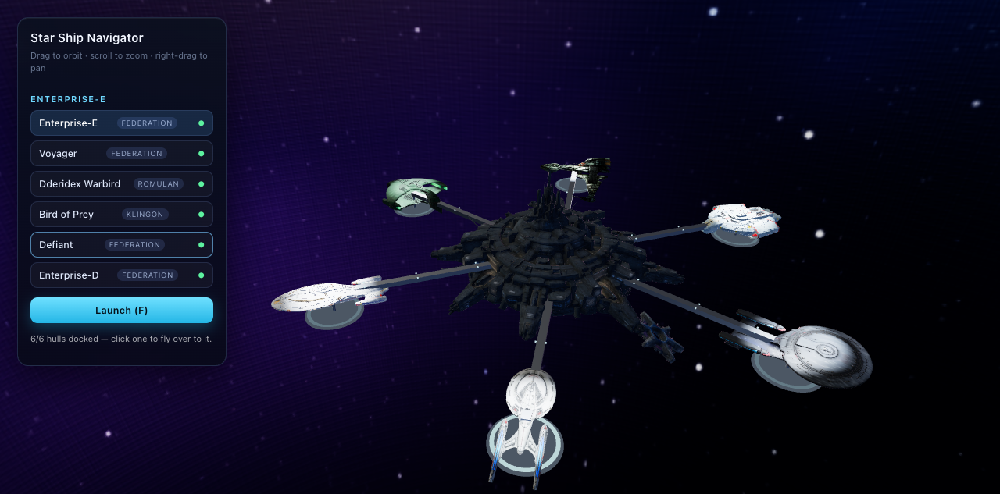
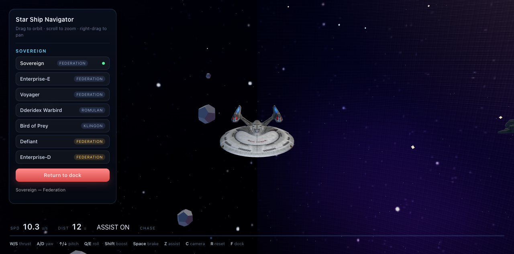

# Star Ship Navigator

A 3D navigator around a spacedock full of Star Trek hulls. Drag to orbit, scroll
to zoom, right-drag to pan, pick a ship from the panel.





## Run it

```bash
cd prototypes/star-ship-navigator
python3 -m http.server 8900
```

Then open <http://localhost:8900>.

**The model files are not in this repo** — see [`MODELS.md`](MODELS.md) for the
exact list to drop into `models/`. Nothing else is required: no bundler, no
`npm install`, no build step.

## The fleet

Six hulls, one berth each, all docked at once. Click a ship in the panel and the
camera flies to its berth; press **Launch** and only that hull leaves the dock.

| Ship | Faction | Berth | Source file |
|---|---|---|---|
| Enterprise-E | Federation | 1 | `star_trek_-_sovereign_class_opt.glb` |
| Voyager | Federation | 2 | `voyager_ncc_74656_opt.glb` |
| Dderidex Warbird | Romulan | 3 | `star_trek_-_dderidex_class_warbird_opt.glb` |
| Bird of Prey | Klingon | 4 | `star_trek_-_bird_of_prey_enterprise_opt.glb` |
| Defiant | Federation | 5 | `defiant_opt.glb` |
| Enterprise-D | Federation | 6 | `enterprised_opt.glb` |

The old Enterprise-E asset (`uss_enterprise_ncc-1701-e.glb`) was dropped — it had
no usable rendering. The Sovereign-class model *is* the Enterprise-E, so it now
carries that name.

## How it works

- **Skybox + lighting from one texture.** A nebula is painted into a 2048×1024
  canvas at runtime (`makeSpaceTexture`). That same canvas is used as
  `scene.background` *and*, through `PMREMGenerator.fromEquirectangular`, as
  `scene.environment`. Without the environment map the glTF hulls — which are
  almost entirely metallic PBR — render black from every angle except the one
  the key light hits. (The old version pointed at a `threejs.org` texture URL
  that returns 404, which is why the nebula kept disappearing.)
- **Per-model axis normalisation.** The source models are authored with
  different forward axes (Sovereign is Z-forward, Defiant is Y-forward, Bird of
  Prey is X-forward). `normalise()` measures the bounding box, rotates the
  longest axis onto X, then applies a hand-tuned `YAW_FIX[id]` so every nose
  points the same way, and scales the hull to a fixed 10 world units.
- **Every model is pre-optimised.** Six hulls are resident at once now, so all of
  them were re-encoded with `gltf-transform` (WebP textures at 1024, meshopt
  compression): Defiant 124 MB → 17 MB, Enterprise-D 127 MB → 11 MB, and the four
  light hulls 41 MB → 4.2 MB. They need `MeshoptDecoder`, loaded in `index.html`.
- **One berth per compass point.** Berth count comes from `FLEET.length`; the berths
  are spaced evenly around the station (`berthAngle(i)`), each with its own spoke
  extruding radially outward and a pad hanging at the far end. Ships are yawed with
  `Math.PI - berthAngle(i)` so every nose points outward along its spoke. Each hull
  lives in its own slot group parked at its berth; flight moves that slot, which is
  why a launched ship leaves the rest sitting on their pads.
- **Floodlights scale with the fleet.** `buildFloods(BERTH_COUNT)` puts one spotlight
  above the end of every spoke, aimed down at that hull.
- **The deck is unlit on purpose.** A `MeshStandardMaterial` deck under four
  floodlights plus IBL washed out to pure white no matter how far the lights
  were dialled back; the deck now uses a fixed dark `MeshBasicMaterial` with a
  translucent cyan inlay ring for the floodlit cue.
- **The station is a real model.** `models/3D.glb` is a Tripo-generated asset
  normalised to a 2-unit cube, so it is rescaled to 2.7× ship length and
  re-centred on load, then hung behind and above the berth. A single gantry beam
  runs from its belly out to the landing pad so the pad reads as part of the
  station rather than a disc floating in space. If the GLB is missing the loader
  falls back to building the old ring, so the scene is never anchorless.
- **Failures are visible.** Every load error is written into the status line and
  the button is marked red — no silent blank canvas.

## Flight model

Space has no air, so there is no drag, no lift, no stall and no weather. That
makes the physics unusual: **nothing slows you down**. Thrust changes velocity,
velocity persists when thrust stops, so a burn is a commitment and stopping means
pointing retrograde and burning again.

| Quantity | Value | Why |
|---|---|---|
| Thrust | 14 u/s² (36 boosted) | a 2 s burn = 28 u/s |
| Rotation | 2.0 rad/s², capped at 1.3 rad/s | attitude is a quaternion, so no gimbal lock |
| Speed cap | 70 u/s soft | a hard limit is kinder than unbounded drift |
| Assist | linear τ 1.1 s, angular τ 0.22 s | bleeds off motion when you release the keys |

Flight assist is on by default (arcade). **Z turns it off** and you get a true
Newtonian ship. Verified in-browser: a 2 s burn reaches 28 u/s, then 2 s of coast
holds 28 u/s exactly while travelling a further 56 units — zero drag. Brake
takes it to 0, one second of yaw rotates the nose from (−1, 0, 0) to
(−0.63, 0, 0.78).

Controls are on the HUD: **W/S** thrust, **A/D** yaw, **↑/↓** pitch, **Q/E** roll,
**Shift** boost, **Space** brake, **Z** assist, **C** camera, **R** reset,
**F** dock/launch.

Since empty space has no landmarks, launch also spawns a dust field, a buoy
field and some rocks — without something to pass, you cannot tell you are moving.

## Dev tools

- `?lineup=1` — lays the light ships in a row so orientation can be checked in a
  single screenshot.
- `?lineup=1&heavy=1` — includes the two optimised heavy hulls.
- `?lineup=1&only=defiant` — a single hull, framed close.
- `window.__nav` — `{ scene, camera, controls, shipRoot, dockGroup, renderer, state }`
  for poking at the scene from the console.

## Next 3 things

1. **Star Wars hulls.** The fleet config is one array; add ISD / Nebulon-B /
   CR90 GLBs to `models/` and a row each in `FLEET`.
2. **Visible floodlight cones.** The four dock floodlights are real spotlights
   but cast no visible beam. A cheap cone mesh with an additive gradient shader
   would sell the "spacedock at night" look far more than more geometry.
3. **Ship turntable.** Right now the dock rotates slowly. Letting the ship spin
   on the pad, with the camera parked, would make the detail in the Defiant and
   Enterprise-D actually readable.
